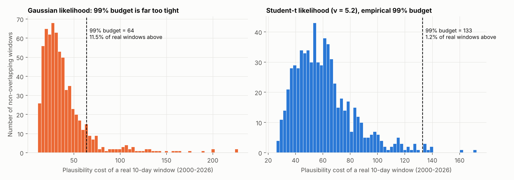
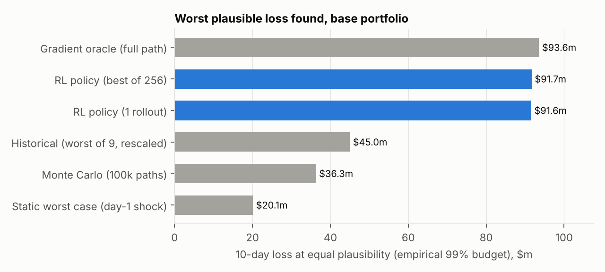
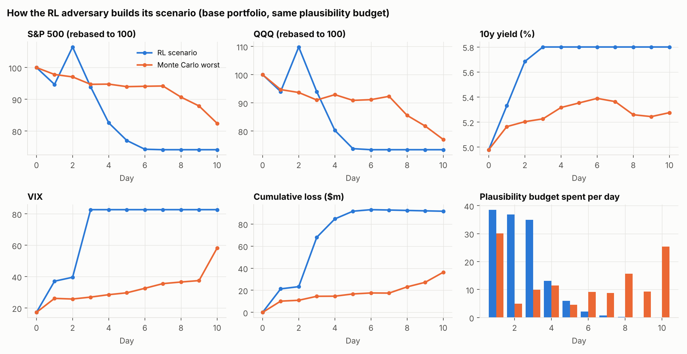
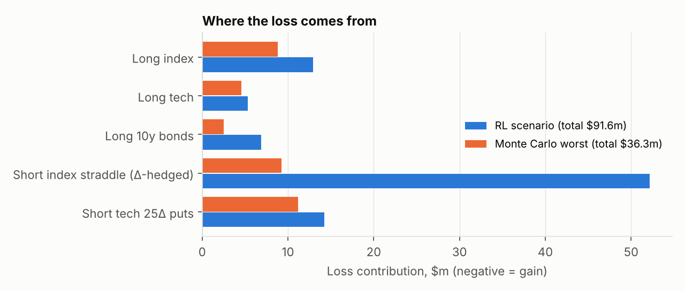
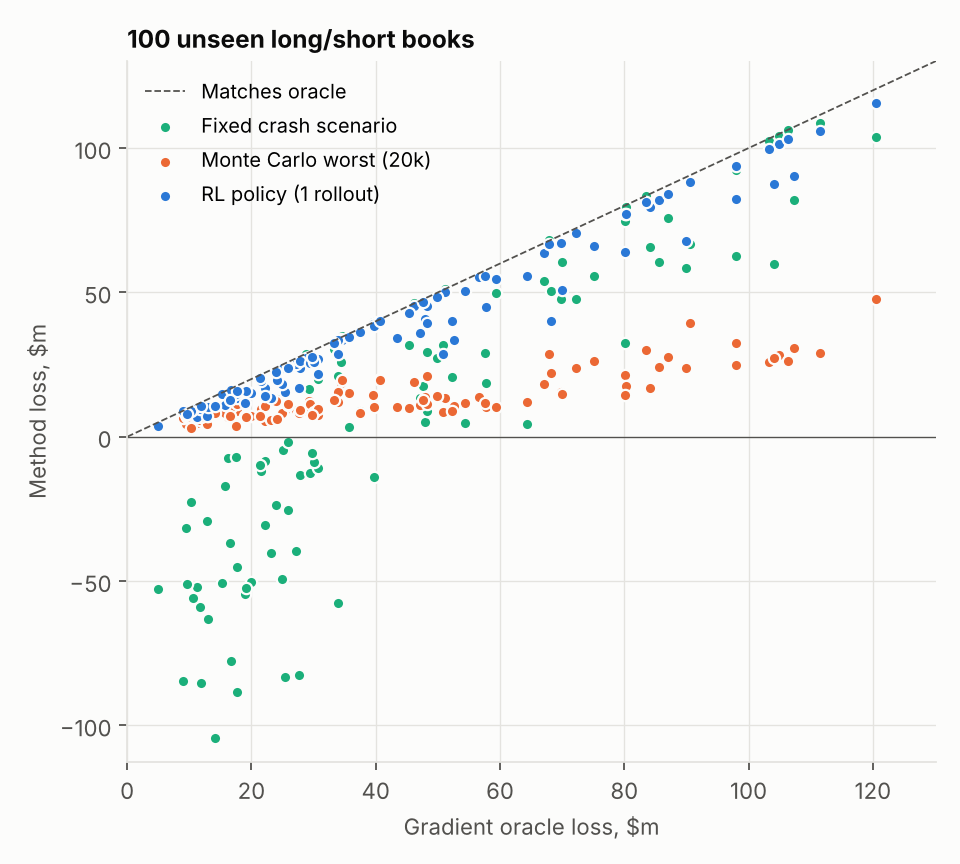
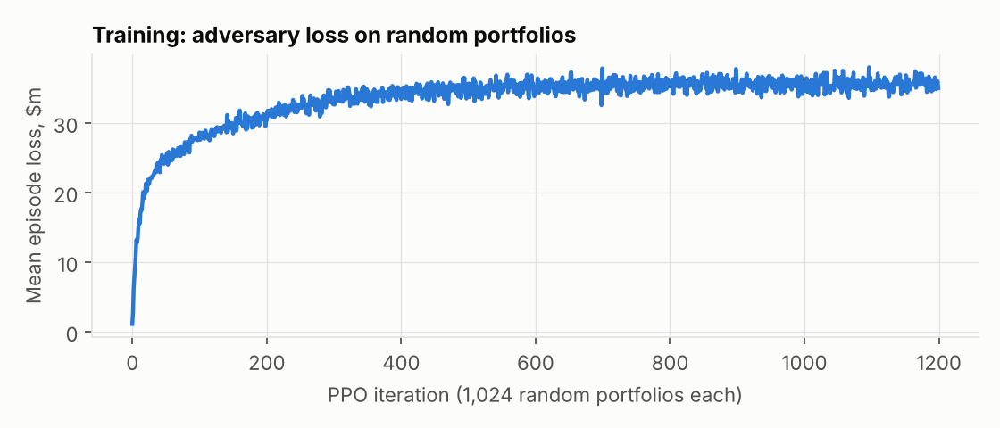

# RL Reverse Stress Testing

**Using reinforcement learning to find the most damaging *plausible* market path for a nonlinear portfolio, with the market model calibrated to 26 years of daily data.**

Classical stress testing asks *"what do we lose if the market does X?"*. Reverse stress testing asks the opposite: *"what is the worst thing the market can plausibly do to this book?"*. This project trains a PPO agent, implemented from scratch in PyTorch, to answer that question for a book of equities, bonds and options. It compares the agent against the standard toolkit (Monte Carlo, rescaled historical crises, a single-day shock) under an identical, data-calibrated plausibility constraint.

## Headline results

On the base portfolio, at the same plausibility (a 1-in-100 ten-day window by the calibrated model):

| Method | Worst 10-day loss found |
|---|---|
| Single-day shock | $20.1m |
| Monte Carlo (100k paths) | $36.3m |
| Worst of 9 real crises (rescaled to the budget) | $45.0m |
| **RL agent (1 rollout, 20 ms)** | **$91.6m** |
| Gradient oracle (10 s) | $93.6m |

- The agent finds **2.5× the Monte Carlo worst case** and **2.0× the worst rescaled historical crisis**, within 2% of a gradient-based optimum.
- On 100 **unseen long/short books** it reaches a median **90% of the oracle**, beats the Monte Carlo worst case on 99 of 100, and is **~800× faster per book**.

## Data and calibration

`calibrate.py` fits the model to daily data from **Jan 2000 to Oct 2026** (6,698 days): S&P 500, QQQ and VIX from Yahoo Finance, and the 10-year Treasury yield from FRED (`DGS10`). `fetch_data.py` re-downloads them.

**Factor dynamics.** Four daily factors, with the equity factors' volatility scaling with the current VIX (so the model is heteroskedastic):

| Factor | Model | Calibrated |
|---|---|---|
| S&P 500 log-return | `0.80 × VIX/√252 × ε₁` | realized vol ≈ 0.80 × VIX (the variance risk premium) |
| QQQ log-return | `1.19 × VIX/√252 × ε₂` | |
| 10y yield change | `5.8bp × ε₃` | |
| log VIX change | `7.2% × ε₄` | |

The correlations of ε are estimated from the vol-standardized residuals (S&P–QQQ 0.85, S&P–VIX −0.79, S&P–yield +0.26). The simulation starts from market levels on 29 Oct 2026 (VIX 17.2, 10y at 4.98%).

**Plausibility: why a Gaussian budget fails.** The textbook approach scores a path by its Gaussian likelihood and allows anything inside the 99% χ² quantile. A backtest on the real data shows this is badly wrong: **11.5% of real 10-day windows exceed the "99%" Gaussian budget**, against the 1% it should be, because daily moves have fat tails (excess kurtosis 1.3 to 6.7).



So this project uses:

1. **A Student-t likelihood.** The decorrelated daily innovations follow a multivariate t, with ν = 5.2 fitted by maximum likelihood (log-likelihood +1,650 vs Gaussian). A path's cost is twice its negative log-likelihood.
2. **An empirical budget.** The budget is the 99th percentile of that cost over real 10-day windows (132.8). The backtest exceedance is 1.2%. For reference, the real 2008 crisis window sits right at the budget, and COVID and Volmageddon sit beyond it.
3. **Hard historical bounds.** No factor moves more in a day than its largest real daily move since 2000 (raw and vol-adjusted). No factor's cumulative move leaves its real 10-day range (S&P −26% to +22%), and the VIX stays within 9 to 83.

In plain terms: **every factor individually stays inside its own history, and the joint path is exactly as likely as a 1-in-100 real 10-day window.** What the methods compete on is how the factors combine and in what order. That is where the risk hides for a nonlinear book.

I added the bounds because an earlier version without them let the optimizer find paths such as S&P −74% with the VIX at 200. Those paths were inside the likelihood budget but plainly absurd, because the model's daily shocks are independent: ten straight −3σ days cost about as much likelihood as the real 2008 path.

## The portfolio

A deliberately nonlinear, path-dependent book ($m notionals):

- Long S&P 500 ($50m) and long QQQ ($20m)
- Long 10y Treasuries ($100m; duration 8.5, convexity)
- **Short 1-month S&P ATM straddle, delta-hedged daily** ($200m notional: short gamma, short vega)
- **Short 25Δ puts on QQQ**, unhedged ($60m notional)

Options are repriced with Black-Scholes, using the VIX as index implied vol.

## Methods compared

| Method | What it does |
|---|---|
| **Monte Carlo** | Simulate 100k paths from the fitted Student-t model, keep those inside the budget, report the worst |
| **Historical (rescaled)** | The worst real 10-day S&P drawdown in each of 9 crises (2001, 2002, 2008, 2011, 2015, 2018, 2020, 2022, 2025), scaled up or down to sit exactly on the budget |
| **Single-day shock** | The classical "maximum loss" stress: the whole budget spent as one day-1 shock |
| **RL agent (PPO)** | Sequential policy: each day it picks a shock direction and how much of the remaining budget to spend |
| **Gradient oracle** | Multi-start Adam through the differentiable simulator over the full path. An upper-bound reference that needs a differentiable pricer and a fresh optimization for every portfolio |

The agent is trained on **randomized long/short books** (each position's size drawn from base × U[−1.5, 1.5]). One trained policy can therefore stress-test a portfolio it has never seen, in a single forward pass, with no gradients through the pricer.

## Results

### Base portfolio



### What the agent found: whipsaw, then crash



The agent's scenario is not simply a bigger crash:

1. **Day 1:** stocks sell off, the VIX doubles, yields jump.
2. **Day 2:** a violent **+12% rally** while the VIX keeps rising. The daily delta hedge on the short straddle was positioned for the sell-off, so it loses on the reversal (classic gamma bleed).
3. **Days 3–6:** the crash. The S&P and QQQ fall to their worst real 10-day levels, the VIX hits its all-time high, and **yields rise 80bp at the same time**, so the bond position fails as a hedge (as in 2022).

It front-loads its plausibility budget into three extreme days and leaves the rest quiet. Real crises look like this, and a Monte Carlo sampler almost never produces such a path.



**The short straddle accounts for $52m of the $91.6m loss.** Monte Carlo's worst path barely touches it ($9m), because a steady decline is easy for a daily delta hedge to keep up with. The real risk in this book is whipsaw plus a vol spike, not the size of the crash.

### Generalization to unseen books

The agent was trained on random long/short books and tested on 100 books it never saw (different seed). Because positions can be flipped, a single "crash" scenario doesn't work: for many books it produces a large *gain*.



| Method (100 held-out books) | Mean loss | Median % of oracle | Time per book |
|---|---|---|---|
| Fixed crash scenario (base book's worst path) | $8.7m | 24% | — |
| Single-day shock | $8.7m | 20% | 168 ms |
| Historical, worst of 9 (rescaled) | $10.5m | 22% | — |
| Monte Carlo (20k paths) | $13.9m | 32% | 95 ms |
| **RL agent (1 rollout)** | **$39.7m** | **90%** | **0.2 ms** |
| Gradient oracle | $44.7m | 100% | 168 ms |



## Repository layout

```
data/            # daily S&P 500, QQQ, VIX (Yahoo) and DGS10 (FRED), 2000-2026
fetch_data.py    # re-downloads data/
calibrate.py     # fits the model -> rst/calibration.json, results/fig0_calibration.png
rst/
  env.py         # batched, differentiable market + portfolio simulator
  ppo.py         # PPO actor-critic, GAE, clipped objective (from scratch)
  baselines.py   # Monte Carlo, historical, single-day shock, gradient oracle
train.py         # trains the agent  -> results/policy.pt
evaluate.py      # runs every method -> results/metrics.json + figures
```

## Running it

```bash
pip install -r requirements.txt
python calibrate.py  # seconds
python train.py      # ~9 min on a laptop CPU
python evaluate.py   # ~4 min
```

## Limitations and next steps

- **Independent daily shocks.** The model has no serial dependence (no vol clustering beyond what the VIX captures, no VIX mean reversion). The historical bounds handle the consequences of this, but a GARCH-style or regime-switching model would be cleaner.
- **The RL agent reaches 90% of the oracle on unseen books, not 100%.** The historical bounds make the reward landscape flatter. Natural next steps are a larger network, a recurrent policy, or a short gradient polish on top of the agent's scenario.
- **Simple option pricing.** Black-Scholes with a flat vol surface driven by the VIX, and QQQ implied vol set to a fixed multiple of the VIX. Skew dynamics would matter for the short puts.
- **One rate factor.** A full yield curve (level, slope, curvature) would be needed for a realistic rates book.
- **Data caveat.** Yahoo data via `yfinance` is unofficial. QQQ uses dividend-adjusted closes; the S&P 500 is the price index.
